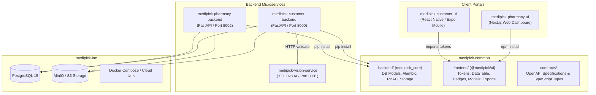

# MediPick System Architecture

MediPick is a microservice platform designed to provide safe, audited, on-demand pharmacy dispensing across Sri Lanka.

---

## 1. System Context Diagram

---

## 2. Repository Roster & Responsibilities

1. **`medipick-common`**:
   * **`backend/`**: Unified SQLAlchemy models, Alembic migrations, RBAC definitions, PayHere payment helpers, MinIO storage.
   * **`frontend/`**: Shared UI design tokens, web dashboard components (DataTables, Badges, Modals, Export), and utility formatters.
   * **`contracts/`**: Centralized OpenAPI schema and TypeScript interfaces.
   * **`docs/`**: Master documentation covering RBAC, metrics, design system, and auth lifecycles.
2. **`medipick-customer-backend`**: Customer OTP auth, drug catalog, cart, prescription uploads, PayHere integration.
3. **`medipick-pharmacy-backend`**: Staff auth, multi-branch isolation, prescription quote acceptance, inventory, analytics.
4. **`medipick-vision-service`**: YOLOv8 deep learning service for prescription NMRA seal detection and Laplacian sharpness scoring.
5. **`medipick-customer-ui`**: Mobile-first customer experience built with Expo and NativeWind.
6. **`medipick-pharmacy-ui`**: Next.js desktop dispensary command center.
7. **`medipick-iac`**: Infrastructure-as-code: Docker Compose, Terraform GCP Cloud Run, and networking.
