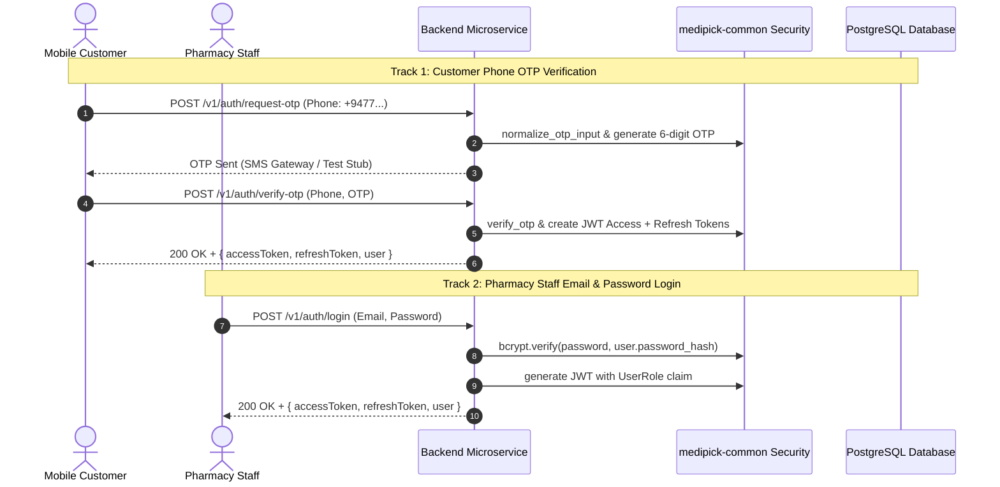

# MediPick Master Authentication & Session Lifecycle

This document defines how authentication, authorization, and session persistence function across customer mobile and dispensary web portal.

---

## 1. Dual-Track Authentication Flows



---

## 2. JWT Token Payload Specifications

All JWT tokens emitted by MediPick adhere to this canonical claims structure:

```json
{
  "sub": "usr_99887766-5544-3322-1100-aabbccddeeff",
  "phone": "+94771234567",
  "email": "pharmacist@citycare.lk",
  "role": "PHARMACIST",
  "pharmacy_id": "phm_11223344-5566-7788-9900-aabbccddeeff",
  "iss": "medipick-auth-engine",
  "iat": 1732500000,
  "exp": 1732503600
}
```

### Token Expiration Standards:
* **Access Token (`ACCESS_TOKEN_EXPIRE_MINUTES`):** **60 minutes** (1 hour).
* **Refresh Token (`REFRESH_TOKEN_EXPIRE_DAYS`):** **30 days** (Stored in database with revocable hash).

---

## 3. Session Revocation & Lockout Rules

1. **Consecutive Failed OTP Lockout:** 5 consecutive failed OTP attempts locks the phone number for **15 minutes**.
2. **Server-Side Token Revocation:** When a staff member logs out or is deactivated, all active refresh tokens are revoked immediately in the database.
3. **Multi-Tenancy Guard:** Requests to `/pharmacy/*` verify that the authenticated staff's `pharmacy_id` matches the accessed resource.
